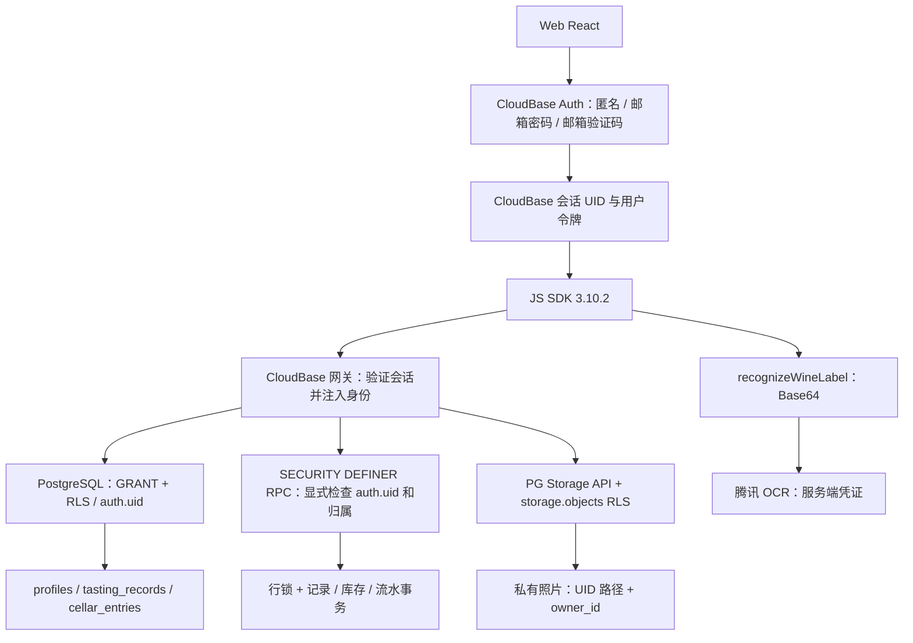
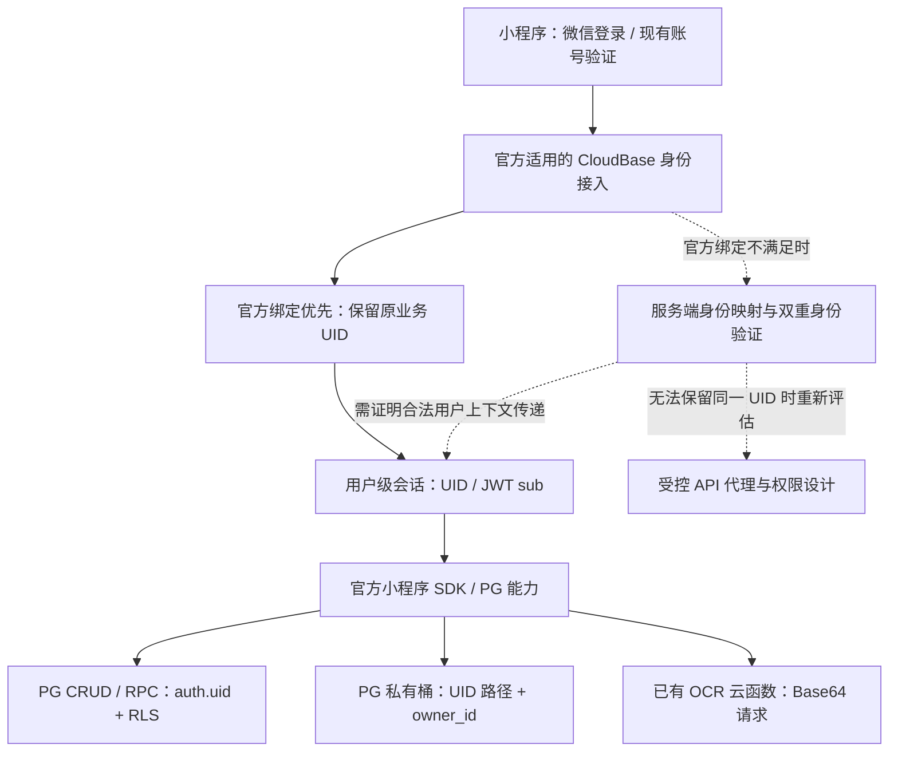

# 微信小程序迁移任务 0.5：CloudBase 后端兼容性验证

审计日期：2026-10-16（Asia/Shanghai）。源码基线：`827e96cef073adbedeffbbec50f88650308287aa`。

## 结论与证据边界

## 当前进展：已授权生产环境内限定测试（2026-10-18）

登录表单修复（后续用户截图）：第二账号尝试显示 `missing_required_param`，提示缺少 `username|email|phone`。该次没有有效邮箱参数，不能判断密码或权限，也不能算第二账号已登录。仅修改独立诊断页：明确输入框与标签、预填用户提供的第二账号邮箱、提交前检查邮箱/密码、默认收起本地 SDK JSON。实际模拟器验证空邮箱和空密码分别显示补填提示；测试期间将登录方法临时替换为调用标志，结果 `loginCalled:false`（验证结束已恢复原方法）。这是本地表单校验证据，不计入真实后端 PASS，第二账号登录及越权测试仍待继续。

用户明确授权“仅创建、修改和清理两个测试账号的测试记录、照片与库存”，取代先前对这些测试数据的写入禁令；历史数据、表结构、RLS、部署仍禁止改动。第二账号由用户注册中。后文“未写生产数据”“还需写入授权”等段落保留为历史，当前范围及最新结果以本节为准。

**Conditional Go，仅继续验证。** 真实小程序模拟器、SDK 3.10.2、基础库 3.17.4、原环境，`urlCheck:false`。邮箱身份已可登录并执行部分数据操作，不代表微信登录绑定或完整越权安全通过。原 37 项矩阵是迁移审计基线；当前新增实测按以下扩展矩阵统计，不与基线相加。

| 项目 | 状态 | 实测证据 / 未完成条件 |
|---|---|---|
| E1 邮箱登录取得 UID、会话一致 | PASS | `SUCCESS_WITH_UID`，`sessionMatchesLogin:true` |
| E2 本人过滤查询接口 | PASS | 初次 `ownRead:SUCCESS,returnedRows:0`，仅接口可调用 |
| E3 完整字段记录新增 | FAIL | `DATABASE_PGRST204: Could not find the 'field_metadata' column of 'tasting_records' in the schema cache`，两次尝试（第二次补充错误摘要） |
| E4 旧表兼容载荷新增 | PASS | 去除 grapes/field_metadata，`insertOwn:PASS` |
| E5 读取已知存在的本人记录 | PASS | 精确 ID 返回一条，note 与插入值相等 |
| E6 更新本人记录 | PASS | 修改 note 后按 ID 再读验证新值 |
| E7 软删除本人记录 | PASS | deleted_at 非空，活动过滤查询返回零行 |
| E8 本地路径字符串上传后的内容正确性 | FAIL | 上传接口成功，但签名下载 HTTP200、65字节、PNG头不匹配；不能认定图片正确上传 |
| E9 ArrayBuffer 上传 | PASS | 本地合成 PNG 经 readFileSync 读字节后上传，路径与预期一致 |
| E10 本人照片签名 | PASS | 实际返回键 `fullSignedURL`，请求有效期60秒；未输出 URL |
| E11 字节上传后的签名访问 | PASS | HTTP200、68字节、PNG头 `[137,80,78,71,13,10,26,10]` |
| E12 测试照片清理 | PASS | remove 后 exists:false；小程序本地测试文件也删除 |
| E13 双账号越权与伪造 uid | BLOCKED | 第二专用账号正在注册，未使用历史数据作为越权目标 |
| E14 临时链接到期拒绝访问 | BLOCKED | 未等待实际到期；文件清理后不能替代过期验证 |
| E15 库存 RPC / 重试 / 原子性 | BLOCKED | 仓库 SQL 不授予普通客户端 cellar_entries/movements 删除权限；先确定精确测试夹具的操作员清理路径，不放宽 RLS |
| E16 OCR 小程序图片调用 | BLOCKED | 本轮未调用 OCR，现有 Base64 接口仍待测 |
| E17 微信身份、Web UID 延续或绑定、正常域名真机链路 | BLOCKED | 本轮仅既有邮箱身份和关闭本地域名检查的模拟器 |

扩展矩阵：**PASS 10 / FAIL 2 / BLOCKED 5**。失败不代表整个后端不可复用：E3 暴露字段完整性差异，E8 暴露上传适配差异。不得把兼容载荷或 ArrayBuffer 成功覆盖原失败。

### 入口与证据

- 记录入口：`miniapp-spike/miniprogram/pages/index/index.js:testOwnRecord` → `owner-record-probe.js`；工具 `automation_evaluate → getCurrentPages()`，调用返回 `ok:true,result.success:true`，以内部 steps 为业务结果。
- 本轮固定测试记录 ID：`32b47abb-7a3d-471a-987b-837f5eae69b0`，wine_name 为 `[MINIAPP-SPIKE] 32b47abb-7a3d-471a-987b-837f5eae69b0`。会话 email 必须匹配预期测试账号；不在报告记录邮箱、UID、密码或令牌。所有更新/清理条件同时匹配 id、user_id、wine_name；新建前按 ID 检查无可见记录，验证清理字段存在。没有调用 Web profiles upsert。
- 记录请求：insert 兼容载荷 → 精确 ID select 校验 → update note → 再读 → finally update deleted_at → 确认原行已软删、活动查询无行。结果 `insertOwn/readKnownOwn/updateOwn/softDeleteOwn:PASS`、`cleanup:SOFT_DELETED_VERIFIED`。
- 照片入口：`testOwnPhoto` → `owner-photo-probe.js`。`tasting-photos/{testUid}/{runId}/miniapp-probe.png`（桶和对象路径分开传），合成1×1 PNG，无真实用户照片。先 exists:false，upload，createSignedUrl(path,60)，wx.request 下载检查字节，finally remove 与 exists 校验。未测试批量签名、跨账号或历史 Web 照片。
- 实验代码自身曾错误假设 list 返回数组，返回 `existing.some is not a function`，当次未上传；修正为 SDK exists 后继续。签名声明示例为 signedUrl，实际对象仅含 fullSignedURL；根据实测修正后验证下载。以上属于诊断代码修正，不能计作生产故障。
- 小程序本地路径参数下载内容65字节并非 PNG，是否被作为路径文本上传仍属推断，未记录该内容；ArrayBuffer 方式下载68字节且PNG头正确，成为当前推荐上传方式。首轮仅“上传成功”的阶段性观察由内容校验结果补充，不能单独算完整上传 PASS。

### 清理与后续

测试图片已物理删除并验证不存在。**一条测试品鉴记录仅软删除，仍保留于数据库回收站，不声称完全清空**。由于当前客户端物理删除被生命周期迁移撤销，保留 `miniapp-spike/evidence/owner-record-manifest.json` 供后续按精确 ID 核对/清理。没有创建库存测试夹具。没有修改历史记录、生产结构、RLS 或正式 Web 代码。

后续需要：第二测试账号；库存测试前可执行的定点清理方案。允许继续仅测试数据的验证，无须重复申请相同授权。生产正式域名修改配额阻塞仍待解决；本地校验跳过不满足发布门槛。

必须适配/核对项新增：核实线上 field_metadata 是否缺失或 schema cache 未刷新（本轮不迁移生产表）；图片上传显式读取 ArrayBuffer；签名响应归一化 fullSignedURL。这些仅在实验代码中实现，正式 API 未修改。


## 2026-10-18 补充：现有环境邮箱登录尝试

### 最新实测：关闭本地域名校验后登录与空结果查询成功

用户确认已勾选本地“不校验合法域名”；读取 `miniapp-spike/project.private.config.json` 确认 `setting.urlCheck:false`、基础库 `3.17.4`。这是用户的本地调试设置，不修改生产 RLS 或云端域名配置。agent 调用 `simulator_refresh` 后，通过 `automation_evaluate → getCurrentPages() → testEmailLogin` 使用同一个已有测试账号执行邮箱密码登录和本人记录只读查询，真实返回：

```json
{
  "stage": "EMAIL_LOGIN_READ_ONLY",
  "login": "SUCCESS_WITH_UID",
  "ownRead": "SUCCESS",
  "phase": "selectOwnRecord",
  "sessionMatchesLogin": true,
  "returnedRows": 0
}
```

环境：`wine-app-d6grgbodge1334980`；AppID：`wx5c33b5cc2b34a20a`；SDK：3.10.2。入口：`miniapp-spike/miniprogram/pages/index/index.js:testEmailLogin`。请求顺序为 `app.auth().signInWithPassword({email,password})`、`auth.getSession()`、`app.rdb().from('tasting_records').select('id').eq('user_id',uid).limit(1)`。未输出 UID、令牌、密码或原始登录响应；未调用 Web 的 profiles upsert，没有写入、上传、OCR 或库存扣减。

**当前补充矩阵 E1 PASS / E2 PASS，共 PASS 2、FAIL 0、BLOCKED 0**，但范围限定为“关闭本地域名检查的模拟器中，既有邮箱账号登录并获得 UID”和“本人过滤查询返回成功且零行”。E2 的零行既可能是无数据，也可能受 RLS 过滤，不能证明用户能读取已知存在的记录，更不能证明跨用户隔离。没有与 Web 实测 UID 对照，没有微信登录或账号绑定，没有登出重登稳定性证据。正常域名校验、真机及发布链路仍 BLOCKED。

原 37 项主矩阵保持 PASS 0 / FAIL 0 / BLOCKED 29 / INFERRED 8，不把邮箱身份与空结果查询冒充微信身份下完整 RLS 验证。最终仍 Conditional Go，仅继续技术验证。接下来需要第二个专用测试账号，以及对“仅两个测试账号的标记记录/照片/库存进行创建、互访、更新、删除和清理”的明确写入范围授权；未获授权前继续遵守生产业务数据不变。

以下域名失败和早期矩阵为历史记录，当前 E1/E2 以上述最新实测为准。


最新外部阻塞：用户在 CloudBase 小程序详情提交 request 域名后，截图显示 `lowcode/SetServerDomain` / `FailedOperation`，服务商平台每月只可修改 50 次，已超限制，本月无渠道新增次数、只能下月修改。页面说明此次数由微信服务商平台统一限制，与平台内其他小程序共享；不能归因于用户本人进行了 50 次修改。截图 requestId：`95659c74-26d6-4b89-a16c-4a5a8f26c598`。该域名保存未成功，E1/E2 继续 BLOCKED。没有重复提交、解除授权或更改生产资源。

可选后续：仅在诊断项目本地开发者工具中临时跳过域名校验，验证邮箱登录/本人只读查询；这种证据必须注明绕过了本地域名检查，不能计作正常域名校验下的真机或发布通过。正式域名配置仍需由平台支持核实处理或待额度恢复后完成。当前尚未执行此本地配置变更。

后续用户截图补充：微信公众平台“服务器域名”显示“服务器域名已托管给第三方，不能在此进行管理”；第三方设置列出“腾讯云官网”和“微搭低代码”。因此上一段微信后台直接编辑路径不适用于当前托管状态。用户先前 CloudBase 小程序认证成功截图中，目标小程序行右侧已有“域名配置”入口；下一步应从原 `wine-app` 环境进入该入口检查 request 域名配置。尚未读取其编辑页或保存结果，不推断具体托管权限归属，不解除第三方授权。

最新诊断（用户提供微信运行时日志，基础库 3.17.4）：`https://wine-app-d6grgbodge1334980.api.tcloudbasegateway.com` 不在 request 合法域名列表中。已确认存在客户端域名拦截，不能将此前 `unknown` 解释为密码错误或服务端身份验证失败。E1 由尝试结果 FAIL 修正为当前兼容性验证 BLOCKED，保留原失败摘要作为历史证据；配置域名后仍须重新执行验证。

最小修复操作：在 AppID `wx5c33b5cc2b34a20a` 的微信小程序后台“开发管理 → 开发设置 → 服务器域名 → request 合法域名”追加该完整 HTTPS 域名，保留已有域名；随后在开发者工具同步项目域名信息并重新编译。继续保持域名校验开启。此次没有修改远程配置，也没有在拦截状态下再次提交凭据。

官方参考：[CloudBase HTTP API 地址](https://docs.cloudbase.net/http-api/basic/overview)、[官方小程序域名配置入口说明](https://docs.cloudbase.net/api-reference/webv2/adapter/uniapp-adapter)。具体需配置的域名来自本次真实错误日志，不照搬不同版本适配器的示例域名。

用户提供了一个测试账号，授权用于验证。凭据未写入项目文件或本报告。本轮未注册用户、未写 profiles、未上传、未调用 OCR、未执行写入 SQL/RPC；尚未取得第二个账号或测试数据写入范围授权。

| 项目 | 状态 | 证据 |
|---|---|---|
| E1：现有邮箱账号在小程序模拟器中登录 | BLOCKED | 已有用户日志确认 request 合法域名拦截；历史尝试： 官方 SDK 3.10.2 `app.auth().signInWithPassword` 实际返回错误；两次受控执行均未得到 UID，首次摘要 `code:unknown`，补充脱敏 message 后为 `code:unknown,message:No message` |
| E2：登录后只读本人 tasting_records | BLOCKED | 登录未成功，查询没有执行，`ownRead:NOT_RUN` |

入口：`miniapp-spike/miniprogram/pages/index/index.js:testEmailLogin`，环境 `wine-app-d6grgbodge1334980`，请求方式为小程序版官方 SDK 邮箱密码登录（不是微信登录）。通过 `automation_evaluate` 从 `getCurrentPages()` 取得当前页执行，工具返回 `ok:true,result.success:true`，业务结果 `login:ERROR,phase:signInWithPassword`。工具成功只表示诊断函数执行成功。未取得服务端 requestId、HTTP 状态或有效 UID；未知错误不足以断定密码错误、域名错误或 SDK 不兼容。

`automation_page_action callMethod` 曾返回 `No context found for objectId 1`；随后受控 evaluate 验证方法存在且 `authResult:null`，改用 evaluate 才取得上述业务结果。CLI 的 `--args` 被拒绝，使用内存管道传入 `--args-file`，未创建凭据文件。console 对 `domain` / `合法` 的筛选均为空，不能据此排除网络配置问题。

独立补充矩阵（域名日志更新后）：PASS 0 / FAIL 0 / BLOCKED 2。原 37 项主矩阵仍为 PASS 0 / FAIL 0 / BLOCKED 29 / INFERRED 8（不将邮箱登录尝试冒充微信登录测试）。总体仍为 Conditional Go，仅继续验证。

现有 Web 的 `acceptAccount → syncProfile` 会 upsert profiles，本轮绕开该封装以保留生产业务数据不变。诊断项目启动仍仅运行本地检查；显式调用 testEmailLogin 才会发起登录，成功后最多只读本人一条记录 ID，不输出记录、UID 或令牌。页面本地检查的零请求字段只对应启动检查，不代表显式登录后的累计请求数。


2026-10-18 再次实测更新：`cloud_env_list --appid wx5c33b5cc2b34a20a` 仍返回 `ok:true,list:[]`；随后按用户已明确提供的原环境执行 `cloud_fn_list --appid wx5c33b5cc2b34a20a --env wine-app-d6grgbodge1334980`，真实返回 `ok:true,result:{appid:"wx5c33b5cc2b34a20a",total:1,list:["recognizeWineLabel"]}`。这证明当前已授权开发者工具的管理查询能读取原环境的云函数列表，空环境列表不再作为“原环境完全不可访问”的依据。环境枚举差异原因尚未确认，不猜测为缓存或必需导入。没有调用 OCR，因此 D1–D4 仍 BLOCKED；该管理查询也不验证终端 UID、RLS、RPC 或私有照片权限。

最新进展（2026-10-18）：用户提供 `wine-app` 环境“小程序认证”页面截图，目标 AppID `wx5c33b5cc2b34a20a` 显示“授权成功”，页面更新时间为 `2026-10-18 02:51:36`。此前管理授权失败已取得后续成功截图证据，不再把旧报错视为最新状态；不推断具体解绑/换绑过程或账号注销撤回状态。随后 agent 真实执行 `wechatide -c Codex cloud_env_list --appid wx5c33b5cc2b34a20a`，返回 `ok:true,result:{appid:"wx5c33b5cc2b34a20a",list:[]}`。因此控制台小程序授权成功与 IDE 可见云环境是两个不同检查，后者目前尚未列出原环境。空列表不能证明环境被删除；需要核实工具会话刷新、已有环境导入及该 PG 环境对当前接入方式的支持。没有部署、调用业务函数或写库。

统计口径：主业务矩阵仍为 PASS 0 / FAIL 0 / BLOCKED 29 / INFERRED 8；独立的管理授权前置检查最新状态为 PASS（用户截图），保留历史 FAIL 记录，不将其算作小程序 UID/RLS 的 PASS。

**Conditional Go：仅允许继续独立技术验证，不允许据此进入正式页面迁移。** 保留 PostgreSQL 的方向有代码与官方能力依据，但当前没有小程序真实环境调用证据，尚不满足 Go 门槛。没有证据表明必须更换数据库，也不能声称现有身份、RLS、存储或 RPC 已兼容。

本报告主验证矩阵共 37 项：**PASS 0、FAIL 0、BLOCKED 29、INFERRED 8**。FAIL 为零表示没有完成真实失败测试，不代表系统没有缺陷。

- PASS：目标小程序与真实 CloudBase 测试环境完成调用并取得符合预期的结果。
- FAIL：上述真实调用完成，但结果不符合预期。
- BLOCKED：缺少外部运行条件，未发出请求；没有返回值、错误码或 requestId。
- INFERRED：仅源码、SDK 声明、SQL 或官方文档提供依据，不能替代集成验证。

没有修改 prototype 页面、样式、后端实现、数据库、RLS 或生产数据；没有部署、发布、提交审核。没有关闭 RLS，没有引入高权限客户端凭证。已创建独立 `miniapp-spike/` 本地诊断小程序，未迁移业务页面。它只读取当前 AppID、检查 wx.cloud 与官方 SDK 导出；不初始化 CloudBase、不登录、不获取 UID、不调用云端业务。真实后端验证仍需独立测试环境。

## 2026-10-18 独立诊断项目

- 新建 `miniapp-spike/`，AppID 为 `wx5c33b5cc2b34a20a`，候选环境仅显示 `wine-app-d6grgbodge1334980`，不连接。
- `scripts/prepare-sdk.py` 从现有依赖复制官方 SDK 3.10.2 的完整 `miniprogram_dist`，实际执行成功；产物 vendor 被忽略，不引入任何凭证。
- `wechatide -c Codex project_import --project /Users/nicki/Documents/ChatGPT/wine-app/miniapp-spike` 真实返回 `ok:true,success:true,alreadyImported:false,projectName:"wine-backend-spike"`。导入成功只是本地工具证据，不计入主业务矩阵。
- `open_project_window --project /Users/nicki/Documents/ChatGPT/wine-app/miniapp-spike --window-mode fullMode` 返回 `ok:true,success:true,type:newopen,winId:s0`。
- 随后 `automation_page_action --project /Users/nicki/Documents/ChatGPT/wine-app/miniapp-spike --action getData --wait-for-selector #diagnostics` 返回 `ok:true,success:true,completed:true`；真实模拟器页面数据如下。此项本地运行检查 **PASS**，独立于主业务矩阵，不代表真实后端 PASS。

```json
{
  "stage": "LOCAL_ONLY",
  "appId": "wx5c33b5cc2b34a20a",
  "expectedAppId": "wx5c33b5cc2b34a20a",
  "candidateEnvironment": "wine-app-d6grgbodge1334980",
  "environmentInitialized": false,
  "sdkVersion": "3.10.2",
  "cloudBaseUid": "NOT_REQUESTED",
  "loginStatus": "NOT_REQUESTED",
  "businessRequestsExecuted": 0,
  "cloudInitialized": false,
  "wxCloudAvailable": true,
  "sdkLoaded": true,
  "sdkInitAvailable": true
}
```

调用入口为 `miniapp-spike/miniprogram/pages/index/index.js:onLoad → runLocalDiagnostics`，请求方式为本地 SDK `require` 和 `wx.getAccountInfoSync()`；未调用云端业务 API。版本字符串由准备脚本校验，本地页不能代替 SDK 网络能力验证。`businessRequestsExecuted` 是页面代码固定的本地阶段说明，非抓包计数。

下一步外部条件：独立非生产 CloudBase PostgreSQL 环境（包含匹配的表/RLS/RPC、私有桶与 OCR 函数）及两个测试用户；提供环境 ID 并在开发者工具完成相应授权即可，勿在聊天发送密码或密钥。当前未授权部署，因此不自动初始化这些云端资源。

## 1. 实际代码定位与本地证据

### 用户补充配置（2026-10-16）

2026-10-17 用户结合 CloudBase 控制台截图确认：正在查看的 `wine-app` 环境 ID 为 `wine-app-d6grgbodge1334980`，与 Web 源码默认值一致。截图显示 SQL 型数据库、云存储、身份认证和云函数入口，但没有展示实际表、登录配置或函数列表。证据类型为用户确认与截图，不是业务 API 实测；尚未核查线上 Web 请求使用的环境、两环境共享/关联设置或小程序到原环境的授权路径。主矩阵数量保持不变。

后续工具连接验证（2026-10-16）：微信开发者工具已安装于 `/Applications/wechatwebdevtools.app`，CLI 安装诊断兼容，版本 `2.02.2608080`；Codex 授权任务返回 `authorized: true`。随后 `check_wechatide_status --skill-version 0.3.11` 返回 `success: true`、`loginExpired: false`、`versionRelation: equal`、`cliTokenRequired: false`。开发者工具安装、登录和 agent 授权阻塞已解除。这里的登录是开发者工具账号登录，**不是业务小程序用户登录，也不是 CloudBase UID/RLS 验证**，不计入主矩阵 PASS。下文原始安装目录检查记录保留为历史证据。

- 用户确认：没有独立非生产 CloudBase 测试环境。
- 已提供小程序 AppID：`wx5c33b5cc2b34a20a`。
- 已提供小程序云开发环境 ID：`prod-d8gnx41fxfc76adf3`。这是用户提供的配置，不是已连接或已验证的环境；不作为测试写入目标。
- 该环境 ID 与 Web 源码默认 `wine-app-d6grgbodge1334980` 不同。尚未核实 Web 部署是否通过环境变量覆盖默认值、两环境所属账号/模式、是否存在共享资源配置，以及实际数据和认证所在环境。不能因同属 CloudBase 就推断 UID、表、照片或云函数共享，也不能断言线上 Web 一定使用源码默认环境。
- 下一轮先只读核实上述环境关系，再准备独立 PG 测试环境。当前任务禁止部署，因此测试环境初始化和 OCR 部署需用户准备或另行授权后续任务。
- AppID、开发者工具安装与授权条件已解除；测试账号与独立环境条件仍未解除。主矩阵状态与数量保持不变，没有新增业务链路调用证据。

用户给出的 `prototype/src/api/*` 和 `prototype/cloudfunctions/ocrWineLabel/` 在当前工作树不存在。搜索得到以下实际实现；本报告代码位置均相对仓库根目录。

| 编号 | 代码位置 | 核查结果 |
|---|---|---|
| S1 | `prototype/src/lib/cloudbase.ts:1`、`:59`、`:88`、`:94`、`:126`、`:137` | SDK 初始化、UID 读取、邮箱登录、匿名升级、登出后新建游客身份；没有独立 auth.ts |
| S2 | `prototype/src/lib/tastingRecords.ts:154`、`:191`、`:211`、`:250` | 批量签名、图片上传、本人记录查询、保存及库存 RPC |
| S3 | `prototype/src/lib/cellar.ts:78`、`:97`、`:121`、`:144`、`:158` | 藏酒查询/新增/编辑、流水查询、consume RPC |
| S4 | `prototype/src/lib/wineLabelOcr.ts:15`、`:32` | FileReader 转 Base64；SDK 调用 `recognizeWineLabel` |
| S5 | `cloudfunctions/recognizeWineLabel/index.js:6`、`:113`、`:129`；同目录 README | Base64 限制、服务端 OCR 凭证、函数输入输出、建议运行配置 |
| S6 | `prototype/cloudbase/postgresql-permissions.sql:9`、`:17`、`:27`、`:57` | 默认 UID、GRANT、启用 RLS、记录 USING/WITH CHECK |
| S7 | `prototype/cloudbase/postgresql-storage.sql:4`、`:27`、`:36` | 私有桶初始化、路径和 owner_id 双重校验 |
| S8 | `prototype/cloudbase/postgresql-cellar.sql:5`、`:45`、`:71`、`:93`、`:135` | 藏酒表、列权限、两个 SECURITY DEFINER RPC、执行权限 |
| S9 | `prototype/cloudbase/postgresql-record-metadata.sql:4`；`prototype/cloudbase/README.md` | 多葡萄/来源字段增量迁移；基础表需要事先创建 |
| S10 | `prototype/src/Prototype.tsx:99`、`:230`、`:450`、`:452` | 图片压缩、识别失败后手工补录、保存条件与保存流程 |
| S11 | `prototype/node_modules/@cloudbase/js-sdk/package.json`；`core.d.ts:1540`；`miniprogram_dist/auth/index.d.ts:127` | 实际安装版本 3.10.2，声明 miniprogram_dist，存在 getUserIdentities/linkIdentity 与 signInWithWechat 声明 |

本地已执行（均不计入云端 PASS）：

1. `rg --files` 与带行号源码读取：确认上述路径；仓库 SQL 只有 4 个增量/藏酒脚本，没有发现 tasting_records、profiles 等完整初始建表定义。线上主键、触发器、其他策略、函数 owner、已应用迁移状态未知。
2. `git rev-parse HEAD`：得到上面的基线；工作开始时 `git status --porcelain` 为空。
3. 查看 `/Applications` 和 `~/Applications`：未发现微信开发者工具；不排除安装于其他自定义目录。仓库未发现小程序 `project.config.json` 或已配置 AppID；用户随后提供的 AppID 见上方补充。
4. `prototype/.env.example` 与 S1 只有默认环境 ID `wine-app-d6grgbodge1334980`。README 称其为开发环境，但没有足够证据确认它是本次可写的隔离测试环境，因此没有向它登录、写入或发起 OCR。
5. 使用本机捆绑 Node 执行 `prototype/scripts/check-mobile-runtime.mjs`：返回 `Mobile runtime integrity check passed (28 protected files).` 这是文件完整性证据，不是后端兼容性证据。Node 路径为 `/Users/nicki/.cache/codex-runtimes/codex-primary-runtime/dependencies/node/bin/node`。
6. 本会话无 CloudBase 管理连接器、授权测试会话、两个测试账号或环境权限快照；未读取或输出任何凭证内容。

## 2. 当前身份与权限链路图

### 原环境登录配置截图证据（2026-10-17）

### 腾讯云管理账号关联失败（2026-10-17，用户实操截图）

2026-10-18 新增用户提供的完整错误证据：`apiIdentifier=lowcode/CheckWedaWxBind`，`code=OperationDenied`，`reqId=d631b9ae-e018-483d-a15b-9f0a2714a931`，`pageUrl=/env/mp-auth`，`v=1.30.8`，原始时间字段 `t=2026-10-18 02:10:24`（日志未标时区），`loginUin=100012859972`，`envId=wine-app-d6grgbodge1334980`。reason 为“当前账号[wx5c33b5cc2b34a20a]已绑定其他小程序，如需继续开通请前往[账号中心]换绑为当前小程序[wx5c33b5cc2b34a20a]”。文案中的“账号”位置也是相同的小程序 AppID，没有给出所谓其他小程序的标识，不能从此字段推断实际绑定对象或账号已成功换绑。可确认原账号下原环境的小程序认证检查仍失败；这是同一管理前置检查的后续失败证据，不新增主矩阵测试项。

此前用户截图显示腾讯云账号进入 90 天注销冷静期，已建议撤回；目前未取得撤回成功或实际绑定关系变化的证据。下一步仅核实原账号账号中心的“微信公众平台/微信公众号”登录方式当前关联项，并确认新账号注销状态；不要按含糊错误文案自动解绑、销毁环境或反复授权。若绑定项与报错不一致，应附上述 requestId 向腾讯云支持查询后台关联记录。

后续账号归属截图：用户以小程序关联账号打开 CloudBase，右上角同时显示主账号与登录账号 `100053814113`；环境名为 `prod`（微信体验版），页面 Base URL 包含 `prod-d8gnx41fxfc76adf3`。据此确认该账号当前可访问此环境。最近一小时图表为零不证明环境无资源，侧栏 SQL 入口也不证明 PG 已开通。尚未取得完整资源清单。

官方换绑 FAQ 的“腾讯云账号注册方式为微信公众平台”分支包含先销毁云开发环境、再解绑并换绑的步骤，另要求保留其他登录方式。这是破坏性路径，不能因为云函数/NoSQL 列表为空就执行；应先由腾讯云支持确认本账号/套餐的适用条件、是否有无损替代及资源影响。本任务不销毁环境、不解绑或换绑、不迁移数据。官方依据：https://cloud.tencent.com/document/faq/876/57380 （2026-10-17 查阅）。

用户提供两张真实控制台错误截图：账号中心当前账号 ID 为 `100012859972`；“微信公众号登录方式关联失败”提示 VinoNote 品酒笔记已于 2026-10-16 14:28:43 在腾讯云注册其他账号 `100053814113`。CloudBase 小程序认证页同时返回 `lowcode/CheckWedaWxBind` / `OperationDenied`，提示当前账号未关联目标小程序 `wx5c33b5cc2b34a20a`，要求先在账号中心关联后重新授权。截图中的 RequestId 被截断，不补造完整值。

该管理账号关联尝试状态为 **FAIL（用户截图证据）**；它不属于主矩阵中业务终端登录/RLS测试，主矩阵仍为 PASS 0 / FAIL 0 / BLOCKED 29 / INFERRED 8。若合并此独立管理前置检查计数，则为 PASS 0 / FAIL 1 / BLOCKED 29 / INFERRED 8；两种统计口径不可混用。A3 等业务验证继续 BLOCKED，不能从管理账号错误推断业务身份绑定 API 永久不支持。

这说明当前腾讯云管理账号与小程序已关联账号不同；旧环境归属和新环境归属的完整资源清单仍需在两账号中核实。腾讯云主账号 ID、数字 APPID、小程序 wx AppID、应用用户 CloudBase UID 属于不同标识，不能互相代替。此前启用“微信开放平台登录”属于应用认证配置，不能解决管理账号关联冲突。

下一步只读：保留原账号会话，另开浏览器会话通过“微信公众号/小程序”登录已有账号，核对账号 `100053814113` 及其环境清单；不创建第三个账号、不自动解绑或迁移。若需换绑，先依据官方账号流程/工单确认资源与访问影响。参考：[CloudBase 账号问题](https://cloud.tencent.com/document/faq/876/57380)、[绑定登录方式](https://cloud.tencent.com/document/product/378/14608)。

同日后续截图更新：用户再次提供该登录方式页面，“微信开放平台登录”显示为**已启用**，取代前一截图的未启用状态；自定义登录仍未启用，页面仍显示“如需管理小程序登录方式，需先进行小程序认证”。这是控制台显示的配置变化，非 agent 操作；没有展示 provider 配置详情、小程序认证结果或业务登录响应。不能据此认定目标 AppID 已关联、原 UID 已绑定或小程序登录已成功。下段保留初始截图记录供对照，当前状态以后续截图为准。

用户提供 `wine-app` → 身份认证 → 登录方式截图，并已确认该环境 ID 为 `wine-app-d6grgbodge1334980`。截图显示：允许匿名登入开关开启；邮箱验证码已启用（标有“代发”）；用户名密码已启用；短信验证码、微信开放平台登录、自定义登录、Apple、Google Web 端、GitHub Web 端未启用。社交登录标题旁提示“如需管理小程序登录方式，需先进行小程序认证”，提供“小程序认证”链接。

这只能证明截图时的控制台显示状态，不能证明邮箱登录实测成功，也不能把“微信开放平台登录未启用”直接等同于“小程序不能接入”。尚需查看小程序认证/关联详情，核对目标 AppID；本次未切换开关、提交认证、绑定或配置密钥。业务验证矩阵状态和数量不变。

### 后续只读云资源核验（2026-10-16）

使用已授权的 `wechatide -c Codex` 执行以下真实管理查询，没有调用业务云函数或读写业务记录：

| 入口与参数 | 实际返回 | 结论边界 |
|---|---|---|
| `cloud_env_list --appid wx5c33b5cc2b34a20a` | `ok:true`；`list:["prod-d8gnx41fxfc76adf3"]` | 当前开发者工具会话下，此 AppID 可见的环境只有该环境；Web 源码默认环境不在本次结果中，不能推断其不存在或永远不能关联 |
| `cloud_fn_list --appid wx5c33b5cc2b34a20a --env prod-d8gnx41fxfc76adf3` | `ok:true`；`total:0`；`list:[]` | 本次指定环境查询未发现云函数，包括 recognizeWineLabel；不是 OCR 业务调用失败测试 |
| `cloud_db_read_struct --appid wx5c33b5cc2b34a20a --env prod-d8gnx41fxfc76adf3 --action listCollections --limit 100 --offset 0` | `success:true`；`collections:[]`；`pager.Total:0`；requestId=`62c96b64-f6db-4714-bbd5-e86491a35a2b` | 返回明确为 NoSQL 集合列表。不能据此判定 PostgreSQL 不存在、PG 表为空或 RLS 不可用 |

上述是成功的管理元数据查询，不是主矩阵要求的小程序终端身份/数据链路测试，因此主矩阵仍为 PASS 0、FAIL 0、BLOCKED 29、INFERRED 8。工具提供的数据库结构入口只列集合/索引，不能替代 PG schema/RLS/RPC 核验。

下一步需要通过现有 CloudBase 控制台会话只读确认 Web 实际环境及其 PostgreSQL、认证和存储配置。当前证据不足以决定把旧数据搬到小程序环境，也未授权新建/部署资源。

下图为源码链路；网关与数据库实际配置尚未核实。



前端 `.eq('user_id', uid)` 只是查询条件，不是安全边界。真正的约束应来自已验证会话映射到 `auth.uid()` 后的 RLS。源码没有自定义 JWT 签发，也没有小程序 OpenID → 现有 UID 的绑定流程。

## 3. 小程序目标身份与权限链路图

这是待验证的混合架构，不表示已实现。



小程序不持有 AppSecret、自定义登录私钥、腾讯云 SecretKey、数据库连接密码或 service_role。自定义身份映射不能让客户端随意声明 UID，更不能自行伪造 JWT sub。

## 4. 主验证矩阵

阻塞条件：X1＝用户确认没有独立非生产环境，实际 PG/Storage 配置未知；X2＝AppID 已提供、开发者工具已登录并授权，但尚无独立验证小程序运行与关联配置证据；X3＝缺两个隔离测试账号及一个已有 Web 账号；X4＝缺测试环境中已部署 OCR 及其调用权限；X5＝缺完整实际表结构/策略/函数定义快照。

以下 BLOCKED 项统一实际结果为：**未调用；无云端响应、错误码或 requestId**。表中的“入口/请求及验收”是待执行步骤，不是本次执行记录。A 为本人，B 为另一个测试用户，所有写操作只能针对独立测试数据。

| ID | 验证项 | 状态 | 调用入口/请求及验收 | 证据与阻塞 |
|---|---|---|---|---|
| A1 | 小程序登录标识与稳定 CloudBase UID | BLOCKED | 官方登录入口 → getSession/getUser；核对 UID、provider、JWT sub 与服务器身份；OpenID 不当成 UID | S1/S11；X1/X2/X3 |
| A2 | 同人在 Web/小程序是否同 UID | BLOCKED | 同环境分别用原账号、微信身份登录；比较服务端验证的 UID，而非昵称/邮箱文本 | S1；X1/X2/X3 |
| A3 | 官方绑定并保留历史 UID | BLOCKED | 已登录 Web 账号 → getUserIdentities/linkIdentity 对应流程 → 微信重新登录；核对 UID 和历史数据 | S11、D2；X1/X2/X3；具体小程序 provider 尚未确认 |
| A4 | 登出、重登、重启稳定性 | BLOCKED | 正式账号连续登出重登、冷启动、令牌刷新；匿名游客单独验证，不能混算 | S1:126；X1/X2/X3 |
| A5 | 映射表必要性与绑定冲突 | BLOCKED | 检验已绑定身份再次绑定其他 UID 是否拒绝；以官方绑定结果决定是否需映射表 | S1/S11；X1/X2/X3 |
| B1 | 读取本人记录 | BLOCKED | 用户 A 的 rdb().from('tasting_records').select；返回测试记录及正确 user_id | S2:211、S6；X1/X2/X3/X5 |
| B2 | 新增本人记录 | BLOCKED | A insert 自己的 UID，再读回验证字段与 auth.uid 归属 | S2:250、S6；X1/X2/X3/X5 |
| B3 | 更新本人记录 | BLOCKED | A update 测试记录 note，再读回；不依赖现有页面是否有编辑入口 | S6:57；X1/X2/X3/X5 |
| B4 | 删除本人记录 | BLOCKED | A delete 独立测试记录，再确认不存在 | S6:57；X1/X2/X3/X5 |
| B5 | 不能读取他人记录 | BLOCKED | A select B 的已知测试 ID；移除 user_id 过滤再读；应不可见 | S6:57；X1/X2/X3/X5 |
| B6 | 不能更新/删除他人记录 | BLOCKED | A 对 B 已知 ID update/delete；B 会话读回确认未改变，不能只看 HTTP 200 | S6:57；X1/X2/X3/X5 |
| B7 | 不能伪造 UID | BLOCKED | A insert user_id=B、把本人记录 user_id 改成 B、篡改/省略令牌；应拒绝或不可操作 | S6、D1；X1/X2/X3/X5 |
| B8 | RPC 身份及越权 | BLOCKED | A 调自己的/ B 的 entry；伪造 p_record.user_id；检查真实所有者和库存，过期/无会话应失败 | S8:78/101/115；X1/X2/X3/X5 |
| C1 | 临时文件上传与保存路径 | BLOCKED | chooseMedia 得 tempFilePath → 官方 PG 桶上传适配；核对返回对象路径及 owner_id | S2:191、S7；X1/X2/X3 |
| C2 | 私有图签名与实际加载 | BLOCKED | createSignedUrls → 真机 image 加载；同时确认无签名访问受限 | S2:154、S7；X1/X2/X3 |
| C3 | 临时链接过期与刷新 | BLOCKED | 短 TTL 测试链接，到期前后以无缓存请求验证，刷新后可读 | S2:165；X1/X2/X3 |
| C4 | 多图批量签名 | BLOCKED | 去重后批量签名，测试多页、部分缺图和签名批量限制 | S2:154；X1/X2/X3 |
| C5 | 跨用户照片越权 | BLOCKED | A 签名/下载/覆盖/删除 B 路径、伪造路径前缀；检查 B 对象未改变 | S7:27/36/45/59；X1/X2/X3 |
| C6 | Web 与小程序共享历史图 | BLOCKED | 同一已绑定 UID 跨端读取历史 PG 对象路径及旧 cloud:// 文件 | S2:158/173；X1/X2/X3 |
| C7 | 绑定后路径与 owner 一致性 | BLOCKED | 比对绑定前后 UID、路径首段、storage.objects.owner_id；异 UID 不能仅改业务行 | S7:32/33；X1/X2/X3 |
| D1 | 小程序文件实际 OCR 成功 | BLOCKED | 临时文件压缩 → 文件系统读 Base64 → callFunction({name:'recognizeWineLabel',data:{imageBase64}}) | S4/S5；X1/X2/X3/X4 |
| D2 | 大小、失败、超时与权限 | BLOCKED | 测空输入、非法 Base64、超限、真实大图、OCR 超时及未授权调用；记录传输和业务错误 | S5:129；X1/X2/X3/X4 |
| D3 | OCR 失败仍可手工保存 | BLOCKED | 小程序中 OCR 失败后确认手填字段、保存测试记录，不依赖识别成功 | S10:230/450；X1/X2/X3/X4 |
| D4 | OCR 与正式存储次数 | BLOCKED | 观测识别与保存网络请求、对象数及失败重试；验证无重复正式照片 | S4/S2:266；X1/X2/X3/X4 |
| E1 | consume 原子性 | BLOCKED | 调 consume 后库存只减指定数量且新增一条流水；非法数量/不足库存无变更 | S8:71；X1/X2/X3/X5 |
| E2 | save_cellar_tasting 原子性 | BLOCKED | 成功时记录+扣库存+流水同时出现；故意非法字段导致整个调用回滚 | S8:93；X1/X2/X3/X5 |
| E3 | consume 重放与并发 | BLOCKED | 库存充足时相同请求两次；库存仅一瓶时两个并发请求；分别检查重复扣减和超卖 | S3:158、S8:71；X1/X2/X3/X5 |
| E4 | save 重放与响应丢失 | BLOCKED | 重放同 record ID、换新 ID、服务端成功后丢响应重试；核对记录/库存/流水 | S2:257/290、S8:93；X1/X2/X3/X5 |
| E5 | 禁止绕过库存事务 | BLOCKED | 直接 update quantity_remaining、insert/update/delete movement 应受限；核验函数 owner/EXECUTE | S8:48/135；X1/X2/X3/X5 |
| I1 | 当前 UID 与会话代码契约 | INFERRED | S1 的 getSession/user.id、getCurrentUser/uid、匿名升级参数；未验证服务器返回 | S1 |
| I2 | 官方小程序/绑定能力存在 | INFERRED | 本地 SDK 有小程序入口与 linkIdentity；官方 PG 小程序示例存在；没有证明本环境可用 | S11；D2/D3 |
| I3 | 行权限设计 | INFERRED | SQL 依赖 auth.uid 与 GRANT/RLS，前端 UID 过滤不承担鉴权 | S6/S8；不是线上策略快照 |
| I4 | 私有照片契约 | INFERRED | UID 路径+owner_id、批量 3600 秒签名、旧文件兼容分支 | S2/S7 |
| I5 | OCR 输入及错误契约 | INFERRED | imageBase64、4,500,000 字符上限、ok/error 返回；未调用腾讯 OCR | S4/S5 |
| I6 | 库存事务与重试风险 | INFERRED | 行锁/单函数事务；无请求幂等键；照片不在数据库事务中 | S2/S8 |
| I7 | 识别与保存解耦 | INFERRED | 识别只传 Base64，正式保存另上传；识别失败保留手工路径 | S4/S10/S2 |
| I8 | 客户端凭证边界 | INFERRED | 检查的业务源码只带 env ID，OCR 凭证在服务端；未有小程序构建包可审计 | S1/S5；不代表所有历史产物已扫描 |

## 5. UID 兼容结论

**尚未证明能够延续或绑定原 UID。** 官方提供身份源绑定 API，安装的 3.10.2 也有 `getUserIdentities`、`linkIdentity` 声明。但“微信开放平台 OAuth 绑定”不能直接等同于“小程序 wx.login 身份绑定”。需要确认当前环境的 provider、账号冲突处理以及实际成功返回。

必须区分：微信登录 code、OpenID、可能可用的 UnionID、CloudBase UID、PG JWT sub。官方旧版独立环境教程明确区分 OpenID 与 CloudBase UID；不能把其 v2 自定义 ticket 示例直接套入当前 v3 PG 环境。官方原生 wx.cloud PG 示例使用 `@cloudbase/wx-cloud-client-sdk`，这是另一个接入分支，也不能假定与现有邮箱会话自动同 UID。

同一个自然人分别首次邮箱登录与微信登录，不足以证明是同一 CloudBase 账户。原匿名注册升级的 `anonymous_token` 只说明已有匿名升级流程，不能证明可绑定一个已经存在的邮箱账户或微信身份。

优先顺序：

1. 在同环境用原 Web 测试账号验证小程序登录与用户会话，作为 PG 可用性的基线。
2. 验证官方绑定到原 UID，验证退出后微信重新登录仍获得原 UID。
3. 只有官方路径不满足才设计 `user_identity_mapping`，建议以 `(provider, app_id, provider_subject)` 唯一映射业务账户，并由服务端验证两端身份。映射表本身不会改变 `auth.uid()`，也不会让 PG Storage 自动认可旧 owner。
4. 若只能产生新 UID，必须重新设计受控代理或身份承接，不能只在请求中附带旧 UID。涉及历史账户合并时另行制定数据与对象归属迁移方案。

原 `signOutToGuest()` 会退出后再匿名登录，匿名 UID 是否变化不得当成正式账号重登稳定性问题。`accountFromUser()` 在 is_anonymous 缺失时把无邮箱判为游客，`syncProfile()` 只区分 anonymous/email，需要适配微信账号。`createTastingRecord()` 还会 upsert 默认游客昵称与 login_type，存在覆盖正式资料风险。

## 6. RLS 兼容结论

**设计可保留，真实正向与越权验证均 BLOCKED。** 当前 SQL 为记录表授予 CRUD，同时用 `USING/WITH CHECK user_id = auth.uid()` 限制行。实际网关应把已验证 JWT 身份注入 PG；不能用客户端解码 JWT 代替签名验证或服务端授权证据。

RPC 是 SECURITY DEFINER：执行权限不能仅依赖普通表 RLS，需要核查函数所有者、search_path、EXECUTE 权限和函数内显式 UID 检查。当前两个函数都拒绝 auth.uid 为空，并以 entry ID + 当前 UID 加锁查询；save 函数写入 user_id 时用 auth.uid 而不是 p_record.user_id。

本地 SQL 不等于线上权限：未知额外 permissive policy、表 owner、触发器和已执行迁移均可改变效果。必须由测试环境管理员提供实际 schema-only/策略/函数快照，再用普通用户 SDK 做真实访问；不能用管理 SQL 中手动设置 JWT claims 的结果冒充小程序测试。

## 7. 私有照片兼容结论

**保存结构明确，临时文件上传适配与跨端访问仍 BLOCKED。** 当前保存的是桶内对象路径 `{uid}/{recordId}/{index}.{ext}`，不是签名 URL。读取时去重并批量签名，目标有效期为 3600 秒；旧 `cloud://` 分支单独换临时 URL。

- 小程序临时路径只在设备端有效，需转换为官方 PG 上传支持的文件输入；不能把路径字符串假装成 Web File，也不能直接套用旧 app.uploadFile 的 fileID 返回契约。选定 SDK 后核对真实返回的 path/id 字段。
- SQL 新建桶设为 private、单文件 10 MiB，允许 JPEG/PNG/WebP/HEIC/HEIF。ON CONFLICT 分支没有重新设置 public=false；必须读实际桶配置，不能以脚本存在证明桶私有。
- 读取/上传策略同时要求路径首段和 owner_id 等于 auth.uid，绑定保留原 UID 是最小影响方案。
- 无法签名他人路径与“拿到他人已签名 URL 是否能访问”是两件事。签名链接应视为限时访问凭据，需验证泄露链接在 TTL 内的行为，日志不能保存完整签名 URL。
- 目前没看到自动刷新过期链接；小程序切后台超过 TTL 后需重新签名。批量签名需验证单次数量限制、部分失败和分页策略。
- 若存储归属统一则历史照片有望共用；若 UID 不同，数据库映射不足以解决路径和 owner 的限制。

## 8. OCR 兼容结论

**最小改动候选为继续传 Base64，不传 tempFilePath 或 fileID。** 当前函数只读取 `event.imageBase64`，不下载 fileID，也不识别设备临时路径。建议临时文件压缩后由小程序文件系统读取 Base64，再通过适用的官方用户级云函数通道调用；具体通道需与环境类型一致，尚未运行。

- 函数限制 Base64 长度 4,500,000 字符，约对应 3.375 MB 二进制上界，不是图片边长限制；还必须测试平台请求体与 OCR 服务自身限制，以更严格者为准。
- Web 压缩最长边 1600、JPEG 质量 0.82，失败时回退原文件，不保证通过上述限制。
- OCR SDK 请求超时配置 20 秒；README 建议云函数 30 秒、Node 20、256 MB。未读取真实部署设置；平台硬超时可能没有机会返回函数里的 ok:false。
- 业务失败返回 `{ok:false,error:{code,message}}`，成功返回 `{ok:true,rawText,wine,year,grape,country,region,confidence}`。调用通道失败另由 SDK code/异常处理。
- 当前 OCR 不写正式照片，正式保存才上传：不是重复存储上传，但图片字节会传输两次。重试保存可能创建新路径并留下孤儿对象。
- 保留“识别请求”与“正式保存请求”分离。若将来为大图改成 fileID/对象路径，需要服务端校验文件归属、生命周期与清理，属于新增 API，不在本次执行。
- 识别失败的 Web 代码仍允许手工保存；小程序对应行为尚未运行。云函数代码未见显式业务用户鉴权或限流，实际调用权限未知，需要测试环境检查。

## 9. RPC、事务与幂等性结论

**数据库原子性有代码依据，身份与重放表现未实测；上线前需要服务端幂等性。**

`consume_cellar_entry`：锁定本人库存行、检查数量、扣库存、插入流水，均在一次函数调用中。行锁能避免并发超卖，但相同请求再次调用时，只要库存足够仍会再次扣减。函数每次生成新 movement ID，无幂等请求参数。

`save_cellar_tasting`：品鉴记录、库存扣减、流水在一个 SQL 函数中，异常应整体回滚。若 record ID 有唯一约束，重放相同 ID 可能触发冲突并回滚，但完整基础表 DDL 未在仓库，不能声称已验证。即使有唯一约束，它也不等于“重放返回原成功结果”的幂等协议。客户端每次 createTastingRecord 都生成新 UUID，重新提交会绕开相同 ID 的冲突保护。

建议未来采用版本化 RPC 或兼容入口：客户端在一次业务操作开始时生成稳定 `request_id`，直到结果确定都复用；服务器以 `(user_id, operation, request_id)` 唯一约束，在同一数据库事务内保存请求摘要和结果。同键同参数返回原结果，同键不同参数拒绝。并发去重也必须在数据库内，不能仅禁用按钮或在进程内缓存。

照片先上传，不在上述数据库事务内；RPC 失败可能留存照片。普通记录 insert 成功后签名失败目前会向上传播异常，可能造成“实际已保存但界面报失败”。需增加稳定保存 ID、可查询保存结果与对象清理方案。

## 10. 推荐架构与决策门槛

推荐 **混合模式：官方小程序 SDK 直连 PG/私有存储与用户上下文 RPC，OCR 继续在云函数运行；身份绑定优先官方能力。** 这不是将所有业务搬到管理员云函数。

| 路线 | 采用条件 | 当前结论 |
|---|---|---|
| 小程序直连 CloudBase PG/Storage/RPC | 用户会话正确注入 auth.uid，原 UID 可延续/绑定，正向与越权测试通过 | 优先验证，尚未放行 |
| 小程序全部走云函数/API | 官方 SDK 在当前环境确有能力缺口；代理能验证用户并保持事务和隔离 | 备选，不应提前增加成本 |
| 混合模式 | 直连数据与存储 + 服务端 OCR；必要时增加受控身份桥接 | 推荐方向，Conditional Go |

如果代理使用 service_role，它会绕过常规 RLS，而且不会自动形成当前终端用户的 auth.uid；不能因此把测试变成管理员查询成功。优先保留平台支持的用户级令牌调用路径。做不到时需单独设计受限服务端入口与授权检查，并重新执行全部越权测试。

## 11. 必须修改的数据库/API 清单（建议，均未执行）

| 类别 | 必须/条件性修改 | 对 Web 的影响 |
|---|---|---|
| RPC 幂等 | 必须为 consume/save 增加稳定请求键、原子去重与结果重放；可新增 v2 函数及去重表 | Web 也应接入；直接增加必填参数会破坏旧调用，需兼容上线 |
| 认证适配 | 必须明确小程序登录与 UID 获取接口；修正无邮箱=游客、profile 覆盖、会话刷新缓存 | 应保留原邮箱/游客流程，账号资料不应被保存记录覆盖 |
| 照片 API | 必须支持临时文件输入、稳定路径、PG 返回值适配、过期重签与失败恢复 | 保持旧 path 和 cloud:// 可读，不批量改历史数据 |
| OCR 客户端适配 | 必须替换 FileReader；保留 imageBase64 契约并处理通道超时 | 原函数契约可继续供 Web 使用 |
| OCR 服务权限 | 若实际缺少调用者校验/限流，必须补齐并控制消耗 | Web 也需带合法用户身份，不能误伤游客 |
| user_identity_mapping | 仅官方绑定不能满足时考虑；单加表无效，需配套授权/会话方案 | 涉及跨端归属，需独立回归和合并策略 |
| RLS/业务表迁移 | 不能预设必须改；先核实实际 schema 和当前策略 | 不应为 SDK 兼容关闭或放宽 RLS |

基础 tasting_records/profiles 建表快照必须补齐，作为可复现测试前提，而不是推测列约束后直接重建。`save_cellar_tasting` 的 p_event_date 最终写入 tasted_at，日期/时区表现也需回归。

## 12. 下一轮真实验证步骤与证据格式

1. 用户确认独立测试环境，提供实际 schema/RLS/RPC/桶配置快照和 AppID；确认既有 OCR 已在该测试环境部署。本任务不新部署任何服务；若缺失，先由用户准备或另行授权后续任务。
2. 微信开发者工具登录、配置项目与合法调用域名/环境关联；关闭“跳过合法域名校验”后再做真机测试。先按环境类型选定一条官方 SDK 链路，固定版本，不混合 wx.cloud 与独立环境 ticket 流程。
3. 准备 A/B 两个测试身份、A 的 Web 账号和少量测试图。用唯一 run ID 标记测试记录和对象，不使用真实用户酒窖作为样本。
4. 先跑 A1–A5；无法证明用户上下文就不执行后续写测试。再跑 B、C、D、E，越权用例只攻击明确的 B 测试对象。
5. RPC 初始库存设置为 2，依次测单次消费、重复请求和并发；另准备一瓶库存验证超卖防护。每次记录调用前后库存、记录数、流水数。
6. 证据记录字段：case ID、执行时间、AppID/环境别名、SDK/基础库/设备版本、用户别名、入口、脱敏参数、响应 code/message/requestId、预期与实际、前后数据断言、清理结果。UID 可用稳定摘要比对，不存 token、密码、完整签名 URL、图片 Base64 或 AppSecret。
7. 测试完成由测试环境管理员清理专用藏酒夹具和流水；当前客户端无 movement 删除权限，不为了清理给客户端增加权限。照片通过 Storage API 删除，不直接删 storage.objects 元数据。

Go 门槛：A1/A2/A3/A4 确认身份与绑定路线；B 至少真实正向和越权通过（最终应完成全组）；C 上传与私有访问通过；D 路径实际成功且失败可恢复；E 身份、原子性和重试处置明确并验证；客户端构建包不含高权限凭证。任一关键项仍 BLOCKED 均不授予 Go。

## 13. 用户需要提供的最小条件

- 一个明确允许本次测试读写、与生产隔离的 CloudBase PG 环境 ID，以及管理控制台的必要只读配置访问或脱敏配置导出。默认 env ID 不自动当作授权测试环境。
- AppID 已提供，开发者工具已安装、登录并完成 Codex 授权，无需重复操作；仍需确认该 AppID 的开发者成员权限及与测试环境的适用关联/登录方式配置。
- 只读确认 Web 当前实际使用的环境 ID，以及它与 `prod-d8gnx41fxfc76adf3` 的关系；提供两环境数据库类型、关联配置和资源概况，不提供密钥。
- 两个可隔离的测试用户 A/B，至少 A 有原 Web 邮箱身份；账号由用户在工具中登录，不把密码发送到报告或聊天。
- 测试环境已准备的表结构、RLS、RPC、私有桶，以及已部署可调用的 recognizeWineLabel。需要服务端 AppSecret/OCR 权限时仅在控制台配置，不提供给小程序。
- 至少一台可预览的微信真机与非敏感酒标样图；确认测试夹具及其清理范围。

没有这些条件时，本次可完成源码/文档核查与测试设计，但不能制造真实通过证据。当前正式迁移准入：**不通过；继续任务 0.5 的环境准备和实测。**

## 14. 官方资料（查阅于 2026-10-16）

- D1：[PG 身份认证](https://docs.cloudbase.net/authentication-v2/auth/auth-pg)：用户令牌与数据库权限链路。
- D2：[v3 PG 身份认证 / linkIdentity](https://docs.cloudbase.net/api-reference/webv3-pg/authentication)：已登录用户可关联第三方身份；小程序具体身份源仍需实证。
- D3：[小程序访问 PostgreSQL](https://docs.cloudbase.net/database/framework-quickstarts/pg/mp)：官方提供 wx-cloud-client-sdk + wx.cloud 的 PG 入口；不证明其 UID 与当前 Web 一致。
- D4：[独立 CloudBase 小程序认证教程](https://docs.cloudbase.net/recipes/add-auth-wechat-miniprogram)：说明自定义登录路线及 OpenID/UID 差别；示例涉及旧 SDK 版本，不能作为当前 v3 PG 兼容证明。
- D5：[PG 存储架构](https://docs.cloudbase.net/storage/pg/introduce)、[上传](https://docs.cloudbase.net/storage/pg/upload)：对象存储与 RLS 链路；不等于临时文件路径已适配。
- D6：[数据库 RPC](https://docs.cloudbase.net/database/postgresql/rpc)：官方函数调用接口；不替代本项目两个函数的真实测试。

文档之间存在版本和接入模式差异；本报告将其作为能力线索，不把教程示例、声明文件或 API 名存在记为 PASS。
